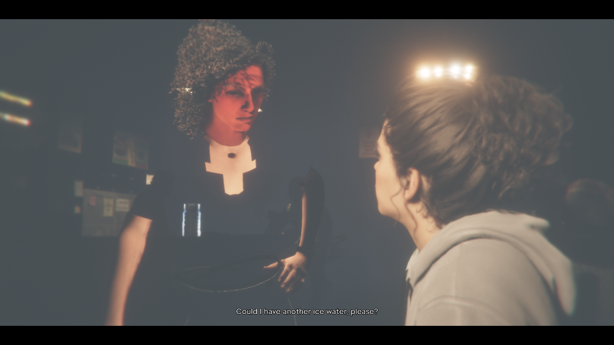
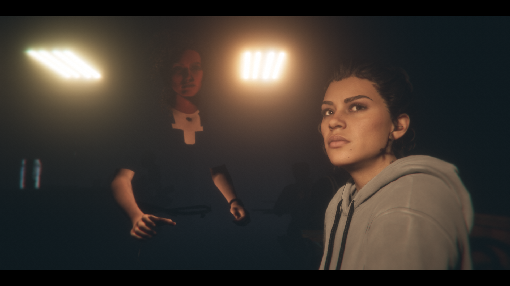

# VIctory rendering work

This branch preserves the local renderer that produced our best documented diner frames on an NVIDIA RTX 3080 Ti. Its rendering source is pinned to `9e05a6eb2a49ceb14370b598c5dfc215ffe03a25`, based on [fxceless/victory-fork](https://github.com/fxceless/victory-fork) at `4e17478b9c27bb530643e5b0e16a767cf4419e08`.

The additions cover texture uploads at submission, depth-twin ordering, placed texture views, packed lighting writes, material image dimensions, physical-page mapping and asset streaming. The 20 source commits preserve their authorship. See [the original project README](UPSTREAM_README.md) and [GPL-3.0 license](LICENSE).

## Reference picture





Both diner characters and their clothing appear in these captures. The later yard is overexposed, and repeated runs can still show dark faces and missing scene surfaces. The scene is affected by streaming and shader preparation timing.

The reference interval contains 16 presented frames over 14.84 seconds, approximately 1.08 FPS. Nearby Windows per-process counters measured 8.34 and 8.64 GiB of dedicated VRAM. The hardware was an RTX 3080 Ti with 12 GB VRAM, i9-14900KF, 32 GB system RAM and Windows.

## Portable runtime

The GitHub release ZIP includes the original renderer binary, a shader-cache preparation binary, checkpoint, settings, launch and memory monitoring tools, Microsoft's signed x64 C++ runtime installer, source history with 59 research branches, local source patches and file checksums.

Extract the ZIP and drag your own game executable onto `Play.cmd`. The first launch prepares the reference shaders from your game files. See [portable instructions](tools/portable/README.md).

## Build from source

Use the Windows Rust/MSVC toolchain and the upstream prerequisites.

```powershell
cargo build --locked --profile diag -p victory --features diagnostics
cargo build --locked --profile diag -p victory-prepare-cache
```

## Reproduce

Supply your game executable and a VIctory player-data directory containing `7952987A\saves`. The runner copies the supplied checkpoint into each session.

```powershell
.\tools\diner\Test-Diner.ps1 -GameExe 'E:\game\game_scarlett_master.exe' -PlayerData 'E:\VIctory\player-data'
```

Add `-WarmCache 'E:\reference-cache'` to use a cache prepared for your executable and GPU driver. The reference started from a verified 2,492-shader cache and a 163,782,710-byte driver pipeline library. Executable fingerprints and driver versions affect cache validity. The first run on a new build compiles its graphics pipelines.

The runner records displayed frames, timings, CPU memory and dedicated/shared GPU memory under its printed session folder. Creating `scene-reviewed.stop` in that folder ends the run after a visual check. Its default duration is 240 seconds. The Series X process working-set ceiling is 16 GiB, with guards at 2 GiB available physical memory and 1.5 GiB available commit. The complete renderer switches are in [reference-settings.json](tools/diner/reference-settings.json).

To assemble another portable runtime, use [Build-Package.ps1](tools/portable/Build-Package.ps1) with the renderer executable, prepared helper, a VIctory checkpoint directory and Microsoft's signed runtime installer. The package's `source.bundle` restores the complete source on a machine with Git.

## Development target

Compare the same diner pose and dialogue when changing streaming, lighting or material handling. Measure the displayed frame interval, draws, pending compilation, texture queue and memory residency together. Current work targets consistently visible walls, faces and clothes, stable streaming through scene changes, and higher gameplay FPS.
